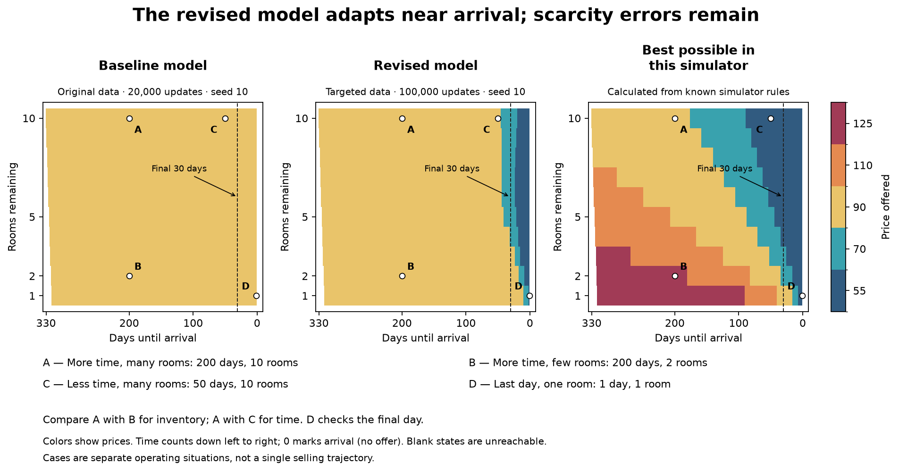
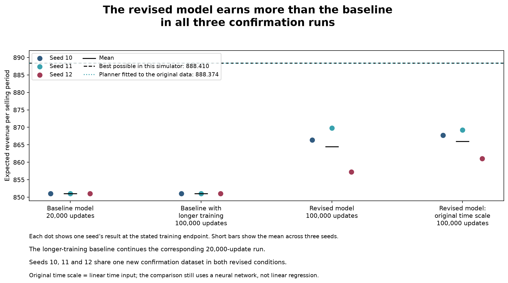
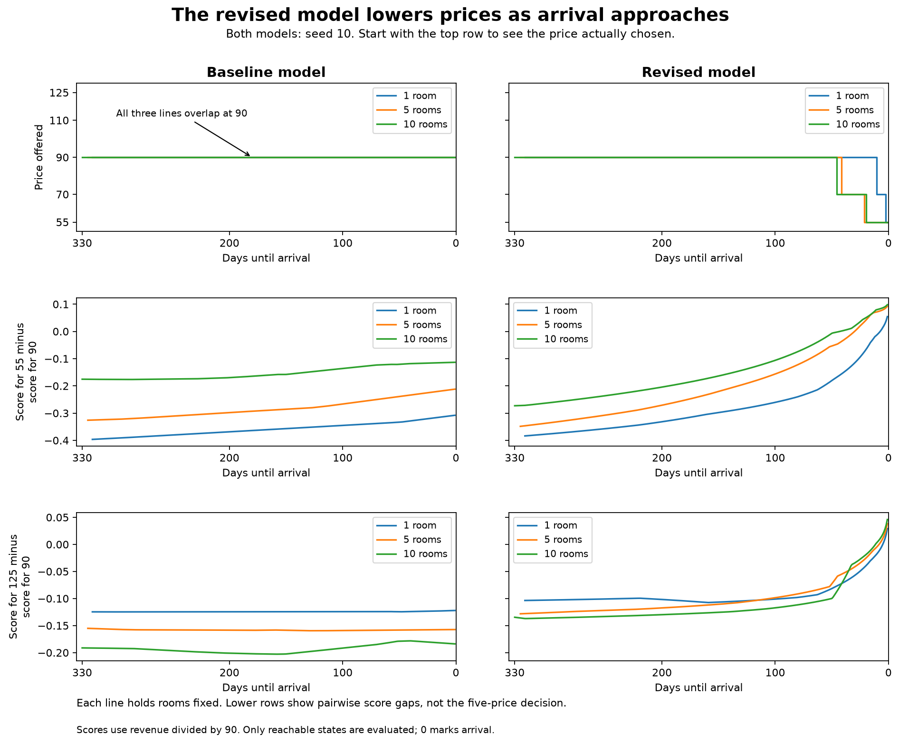
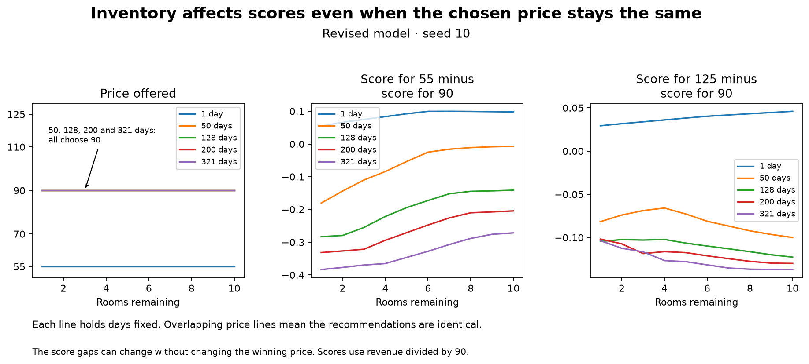
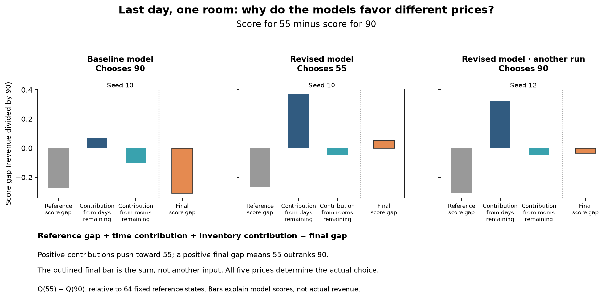
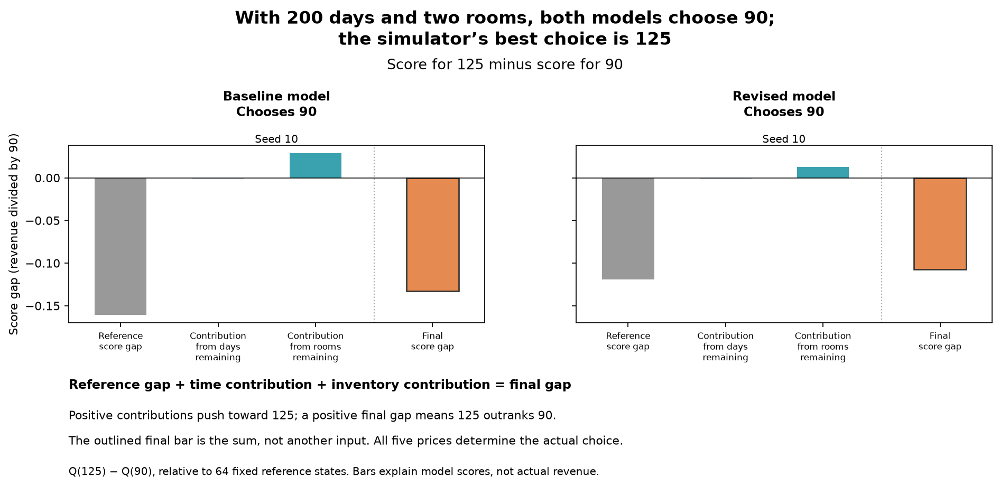

# Explaining and Improving a Hotel Pricing Policy

Hotel pricing balances sales before arrival against the value of keeping rooms for future opportunities. In this simulator, the best policy changes with both time and inventory. The original offline reinforcement-learning model mostly charged 90 across these different situations.

Policy maps, score explanations, and diagnostic tests investigated this limited adaptation. Additional simulated experience and training changes improved full-period revenue. The improvement was uneven: decisions improved substantially near the deadline, while important earlier decisions remained weak.

## What pricing problem does the study address?

The capstone with SAS studies pricing learned from experience. Partner data was undergoing confidentiality checks and anonymization, so simulated decisions provided a controlled starting point. Public reservations helped establish a selling window and reference price. They did not reveal every offered price, rejected offer, or inventory level. The simulator's demand curve is therefore an explicit assumption.

The hotel starts with **330 days and 10 rooms** for one arrival date and one night. Each day it offers 55, 70, 90, 110, or 125. At most one room sells, and unsold inventory carries forward. The probability of a sale at a given price stays constant, but the value of retaining a room changes with time and inventory.

Performance means expected revenue over the **complete selling period**. It includes future sales, not just today's offer.

<!-- headline:start -->
The baseline model earns **851.003** revenue units per selling period. The revised model averages **864.469**, compared with **888.410** for the best possible policy in the simulator. The improvement is **1.58% of original revenue**, or **36% of the original shortfall**.
<!-- headline:end -->

Recovering 36% of the gap means closing about a third of the original shortfall to the simulator optimum. It does **not** mean a 36% revenue increase.

> **Terms used below**
>
> - **Policy:** a rule that chooses a price from days and rooms remaining.
> - **Q score:** the model's estimate of revenue from a price, including future sales. It can be wrong.
> - **CQL:** Conservative Q-Learning, the neural training method used here. It fits saved decisions and outcomes while discouraging overly optimistic scores relative to recorded actions.
> - **Margin:** one Q score minus another; its sign shows which of those two prices the network favors.
> - **Planner:** a separate method that estimates sale probabilities and calculates a policy using known inventory dynamics.

## Where does the original policy fail to adapt?

Charging 90 is sometimes appropriate. With 200 days and 10 rooms, it is the simulator-optimal choice. With the same 200 days but only two rooms, the best policy charges 125: scarce inventory is worth retaining for later opportunities. With 50 days and 10 rooms, the best policy discounts to 55 to reduce the risk of unsold rooms.

The learned policy's weakness is insufficient adaptation across these situations. The map previews the revised model, whose training changes are examined below.

**Figure takeaway: Learned policies miss much of the optimum's inventory response, even after improving near the deadline.**

**Baseline model:** original data and training setup, with 20,000 updates. **Revised model:** additional targeted observations, more attention to late-period records, logarithmic time input, and 100,000 updates.

*Each map shows the price offered for days until arrival and rooms remaining. Colors indicate prices; time counts down left to right. The dashed line marks the final 30 days. The A–D key is embedded below the maps. Both learned examples use seed 10. Blank states are unreachable. Notebook 1 separately shows the original saved model (historical seed 0).*

## What did the diagnostic evidence reveal?

Model scores and simulator values answer different questions. Scores show what the neural network prefers. Simulator action values check the consequences of a price, including later sales. At an earlier state such as 200 days and two rooms, those values must specify whether later decisions follow the learned policy or the optimum. Same-day price times sale probability alone cannot explain the scarcity tradeoff.

Local records can be sparse even when the whole dataset is informative. The planner pools recorded offers by price, estimates sale probabilities, and accounts for the value of retaining inventory. This is possible because demand is stationary and depends only on price here.

<!-- planner_summary:start -->
Using only the original records, the planner earns **888.374**, close to the simulator's best possible **888.410**. No extra sample collection is needed to fit it.
<!-- planner_summary:end -->

The planner supplies an achievable reference point from the original data. It is a separate policy, not evidence that the neural network learned this calculation. The simulator optimum remains the upper benchmark.

### What does a simple final-day check tell us?

The final day removes future revenue from the calculation. With one day and one room, expected revenue is **8.342 at price 55**, versus **3.273 at price 90**. The original saved model still chooses 90. There are only 37 original offers at that exact state, including three at 55 with no sales. Across the whole dataset, however, price 55 has 32,492 offers and 4,931 sales.

Implausibly high final-day scores prompted checks of input scaling, price indexing, reward units, and episode endings. These checks found no defect in the tested mechanics. Even an extreme next-state prediction was correctly excluded from the final-day target. With many independent final-day observations at every price, both a direct network fit and ordinary minibatch training selected 55.

This compact diagnostic supports investigating data and learning. It does not establish that the network can solve the complete inventory problem.

## Which changes were tested?

The first experiment added complete simulated selling periods. Neither collection arm established improvement. Only 22 of 400 added periods per arm reached the final 30 days, leaving that region sparsely observed.

The follow-up distinguished three approaches:

| Approach | Adds new data? | Needs new simulator samples? | Changes neural-network training? |
| --- | --- | --- | --- |
| Late-window replay | No | No | Yes: revisit existing late-window records |
| Balanced probes | Yes | Yes | Yes: fit the augmented dataset |
| Learned-demand planner | No | No | No: calculate a separate policy |

The planner uses known inventory dynamics. All policies use the simulator for evaluation; the sample column refers to collection.

Replay and longer training produced little revenue improvement. Balanced probes supplied 100 outcomes for every price at every time-and-inventory combination in the final 30 days: **150,000 new one-step outcomes**. Sales and no-sales were retained. A comparison collected the same number at already familiar combinations.

**Collection was active and targeted; training then used a frozen dataset.** Fitting remained offline, while the overall workflow required additional simulator access.

Balanced data helped in development. A logarithmic time input, which gives more resolution near the deadline, helped further in those initial runs. The revised model combined balanced data, late-window replay, logarithmic time, and 100,000 updates. Its settings were fixed before confirmation.

## Did the full pricing policy improve in confirmation?

Confirmation used one newly collected balanced dataset and three unused training seeds. Seeds change starting weights and sampled batches. Baseline comparisons checked both 20,000 and 100,000 updates. A matched revised model with the original time scale kept the revised model's data, replay, and budget, changing only the time input.

<!-- confirmation:start -->
| Seed | Baseline model | Baseline with longer training | Revised model | Revised model: original time scale | Gain over baseline |
| --- | ---: | ---: | ---: | ---: | ---: |
| 10 | 851.003 | 851.004 | 866.367 | 867.757 | +15.364 |
| 11 | 851.003 | 851.003 | 869.806 | 869.245 | +18.803 |
| 12 | 851.003 | 851.003 | 857.234 | 861.029 | +6.231 |
<!-- confirmation:end -->

*The baseline uses 20,000 updates. The longer-training baseline and both revised conditions use 100,000. “Original time scale” means linear time input instead of logarithmic time; this comparison is still a neural network, not linear regression. Exact experiment IDs remain in the supporting records.*

**Figure takeaway: The revised model improves in every seed; logarithmic time has no consistent extra advantage.**

*Each dot shows one seed’s result at the stated training endpoint. Short horizontal bars show the mean across the three seeds. The longer-training baseline continues the corresponding 20,000-update run. The three seeds share one new confirmation dataset in both revised conditions.*

The revised model met the planned target: recover at least 10% of the original gap and improve in all three seeds. The revised model with the original time scale did slightly better on average and won in two seeds. Confirmation supports the tested combination, but not a repeatable added benefit from logarithmic time.

## Where did decisions improve, and where do weaknesses remain?

These four fixed cases illustrate different operating conditions. They are neither a trajectory nor a representative sample of all states. All six original cases remain in the supporting evidence.

<!-- illustrative_cases:start -->
| Situation | Best possible in this simulator | Baseline model, all seeds | Revised model: seeds 10 / 11 / 12 |
| --- | ---: | ---: | --- |
| A — More time, many rooms: 200 days, 10 rooms | 90 | 90 | 90 / 90 / 90 |
| B — More time, few rooms: 200 days, 2 rooms | 125 | 90 | 90 / 90 / 90 |
| C — Less time, many rooms: 50 days, 10 rooms | 55 | 90 | 90 / 55 / 70 |
| D — Last day, one room: 1 day, 1 room | 55 | 90 | 55 / 55 / 90 |
<!-- illustrative_cases:end -->

The 200-day pair shows a remaining scarcity failure: every revised model still chooses 90 with only two rooms. The 50-day case shows that discounting can matter before the terminal boundary, and that learned choices differ across seeds. Seed 12 retains the final-day mistake yet improves full-period revenue by **6.231** units. One terminal decision cannot serve as the acceptance test for the full policy.

**Common-reference regret** measures losses from decisions using the same fixed-90 visitation weights for every policy. It locates improvement while keeping the weighting of situations constant.

<!-- regional:start -->
| Region | Baseline model | Revised model, mean | Reduction |
| --- | ---: | ---: | ---: |
| Final 30 days | 17.435 | 4.703 | 73.0% |
| Earlier days | 19.972 | 18.827 | 5.7% |
<!-- regional:end -->

The intervention reduced this measure by about **73% in the final 30 days**, but only **5.7% earlier**. Earlier weaknesses remain largely unresolved. These regional measures are not the revised model's own revenue-gap components; they must not be added and presented as its actual gap.

**Figure takeaway: The revised model changes discounting near the deadline, while much of the earlier price response remains flat.**

**Figure takeaway: Scores respond to inventory even when their winning price does not change.**

A flat recommendation does not prove that the model ignores inventory. Inputs can change scores without changing which of the five scores is largest.

### How did the model's price preferences change?

**Shapley attribution** divides a score comparison into contributions from time and inventory, relative to reference situations:

`reference margin + time contribution + inventory contribution = current margin`

For discounting, `Q(55) − Q(90)` is positive when 55 outranks 90. At one day and one room, the revised model's seed-10 time contribution offsets the negative reference and inventory contributions. Its margin becomes positive and its full choice is 55. Seed 12 retains a negative margin and chooses 90.

**Figure takeaway: Discounting improves in seed 10, but the same local preference remains wrong in seed 12.**

For scarcity, the companion comparison is `Q(125) − Q(90)` at 200 days and two rooms. Both illustrated models still favor 90 over 125, even though the simulator optimum charges 125.

The first three bars add to the outlined final score gap; it is not a fourth input. Positive contributions push toward the alternative price, and a positive final gap means that price outranks 90. Scores use revenue divided by 90. These explanations describe network preferences, not actual revenue or causal effects. The full choice always checks all five prices. The method follows [Lundberg and Lee's Shapley framework](https://arxiv.org/abs/1705.07874); reference definitions and sensitivity checks are in the appendix.

## What did XAI help reveal?

| Question | Evidence | Contribution |
| --- | --- | --- |
| Does the policy adapt? | Policy maps | Locate limited adaptation across the full task |
| How do inputs affect recommendations? | Direct response curves | Separate score sensitivity from changes in the chosen price |
| Why does one price outrank another? | Shapley score contrasts | Describe a local preference relative to reference situations |
| Are decisions useful? | Simulator values, regional regret, full-period returns | Evaluate decision quality and the intervention |

Explanations exposed weak decisions and helped formulate tests. Controlled evaluation established the revenue gain and located its uneven improvement. Earlier scarcity decisions remain a concrete limitation.

## What does this not show?

- **Real-hotel performance:** the simulator assumes a demand law and simplified inventory dynamics.
- **Independent dataset replication:** three confirmation seeds share one new collection.
- **An isolated benefit from every component:** the package improves, but the log-time advantage did not consistently confirm.
- **A causal benefit from XAI:** there was no XAI-versus-no-XAI experiment.
- **Accurate values everywhere:** better decisions coexist with Q-score errors, including negative scores.
- **A general planner guarantee:** its strong result relies on the correct stationary, price-only demand structure.

## Where can the work be inspected?

Read [the policy audit](../../notebooks/policy_improvement/01_policy_audit.ipynb), followed by [learning improvement](../../notebooks/policy_improvement/02_learning_improvement.ipynb). The [repository README](../../README.md#saved-evidence-supports-reproduction) explains reproduction. The [poster](poster.pdf) presents the completed study.

## Appendix: How were the results checked?

### Which experiment does each display name identify?

<!-- model_names:start -->
| Experiment ID | Display name |
| --- | --- |
| `CONF_U20` | Baseline model |
| `CONF_U100` | Baseline with longer training |
| `CONF_C100` | Revised model |
| `CONF_L100` | Revised model: original time scale |
<!-- model_names:end -->

These labels describe model roles. Checkpoint paths and experiment IDs remain unchanged in the supporting files. The original saved model is the historical seed-0 checkpoint, separate from the fresh baseline models. In the first collection experiment, “+400 usual-price periods” and “+400 late-exploration periods” describe additions to the original dataset.

### What do the detailed performance measures mean?

**Regret** is revenue lost relative to the best available decision or policy in the simulator. Actual total regret is the best policy's return minus the learned policy's return.

**Common-reference regret** compares policies using the same weighting of situations: how often a fixed-90 policy visits each one. It helps locate improvement without letting different visiting patterns change the comparison. It is not the learned policy's actual total gap.

Per-seed regional values remain in Notebook 2. The main-text table reports means across the same three confirmation seeds.

### How were explanations and alternative situations checked?

The fixed margins are Q(55) − Q(90) and Q(125) − Q(90). Explanations use 64 original-training reference states and six fixed cases: `(200, 2)`, `(200, 10)`, `(50, 10)`, `(1, 1)`, `(128, 1)`, and `(321, 10)`. Each model applies its own preprocessing once.

The full grid has 3,255 reachable states. Feature exchanges for Shapley calculations stay within days 1–321 and rooms 1–10. The other 45 reachable states still count in policy evaluation.

<!-- sensitivity:start -->
Across 144 confirmation model/case/contrast explanations, the alternative reference changes the sign of 6 time contributions and 4 inventory contributions. The direct model scores and actions stay unchanged. Reference choice therefore matters for interpretation even when reconstruction is exact.
<!-- sensitivity:end -->

Direct response curves evaluate the network while changing one input and holding the other fixed, in the style of [Individual Conditional Expectation](https://arxiv.org/abs/1309.6392). Price curves use steps; impossible states are excluded.

A **counterfactual state comparison** asks which nearby possible situation would change the recommendation. The search uses distance `abs(change in days)/330 + abs(change in rooms)/10`, with fixed tie-breaking. It checks the full five-price choice and retains cases with no solution. A future-only version also forbids moving backward in time or selling more rooms than elapsed days permit. These are comparisons, not instructions to change time or remove inventory. See [Wachter et al.](https://arxiv.org/abs/1711.00399) for the broader explanation concept.

For earlier-day simulator action values, the case table explicitly assumes offering a price now and following the named policy afterward. Neural scores, those simulator values, and values assuming optimal continuation remain separate.

### What supports the planner and fitting checks?

<!-- planner:start -->
| Price | Training offers | Sales | Estimated sale probability |
| --- | ---: | ---: | ---: |
| 55 | 32,492 | 4,931 | 15.176% |
| 70 | 48,749 | 4,103 | 8.417% |
| 90 | 162,057 | 5,820 | 3.591% |
| 110 | 48,427 | 759 | 1.567% |
| 125 | 32,535 | 274 | 0.842% |

The learned-demand planner earns **888.374**, compared with **888.410** for the known-simulator optimum. Its remaining gap is **0.036580** revenue units.
<!-- planner:end -->

The terminal fitting check used 10,000 training outcomes and 2,000 independent evaluation outcomes per price. A deterministic network fit matched the empirical objective within 0.001 at penalty weights 0 and 0.1. Minibatch fitting also selected 55, with residual error.

Historical target-network state was unavailable, so historical residuals use a labeled online-network proxy. New checkpoints retain the actual target network. The displayed bound count checks upper bounds only. A zero count does not establish calibration, and a negative value alone does not prove a bug.

The learner is a discrete implementation of [Conservative Q-Learning](https://arxiv.org/abs/2006.04779). Complete settings are in the frozen configurations, rather than inferred from the plots.

### Which records preserve the full investigation?

The 26 reported checkpoints come from 19 training trajectories; continued checkpoints are not independent runs. The original episode experiment, every development result, and all confirmation seeds remain available. The familiar-versus-balanced data comparison was developmental and was not separately repeated in confirmation.

The [metrics](evidence/final_metrics.csv), [claim ledger](evidence/claim_evidence.csv), [confirmation cases](evidence/confirmation_cases.csv), and [evidence inventory](evidence/evidence_inventory.json) retain the detailed comparisons.
